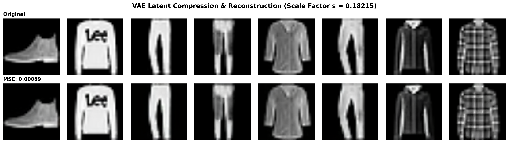
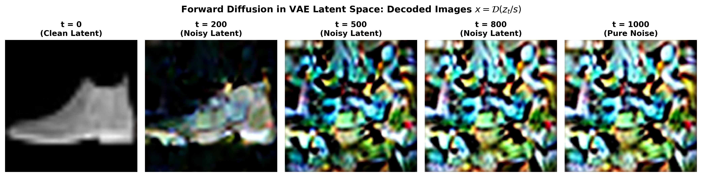
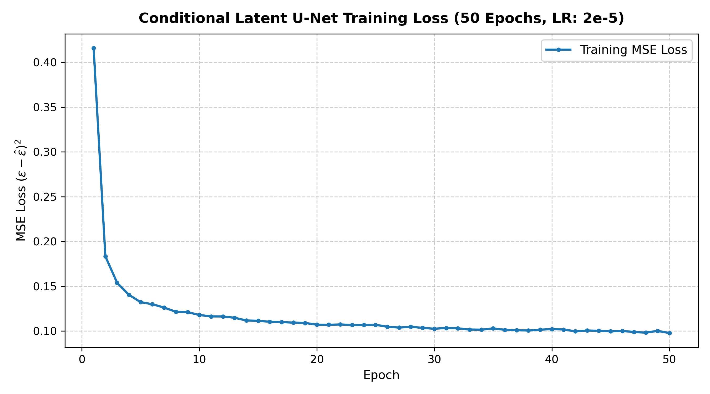
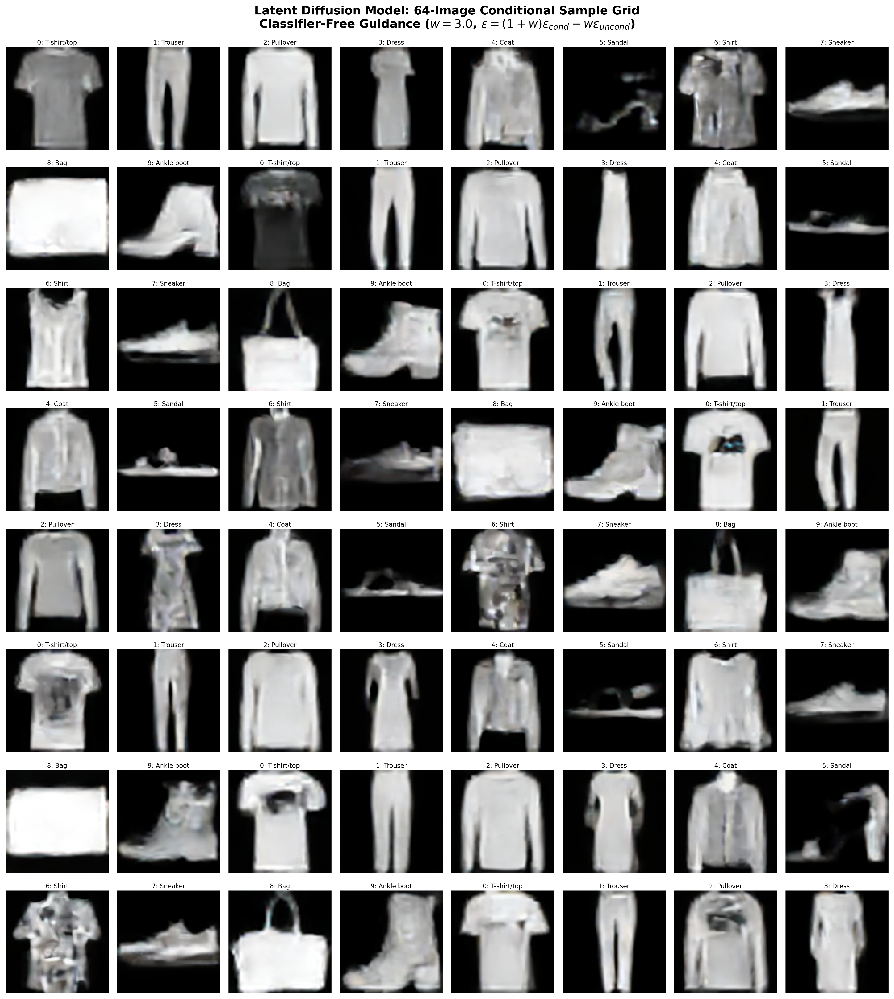
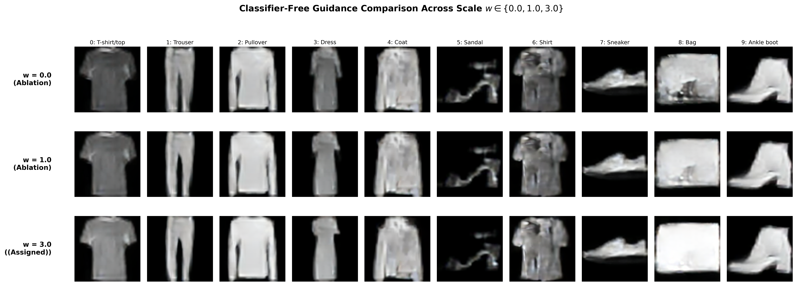
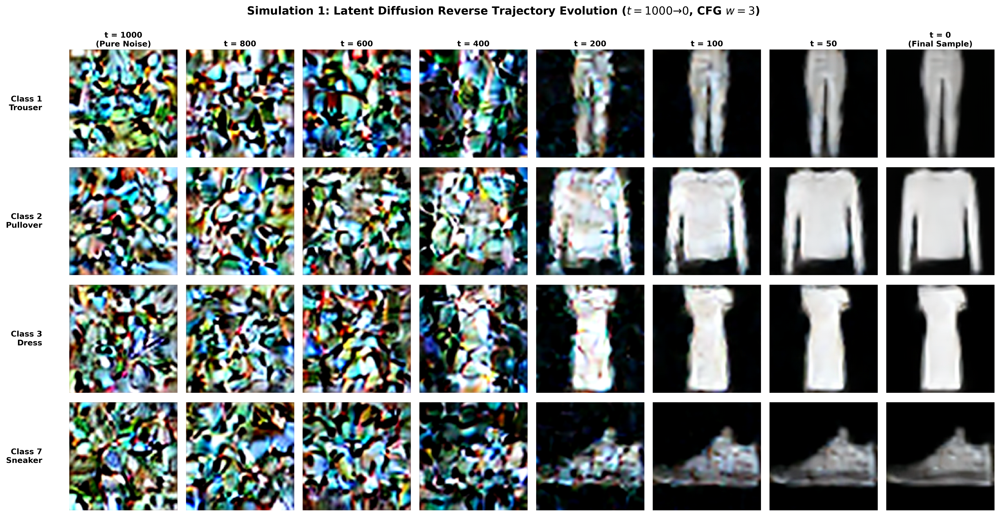
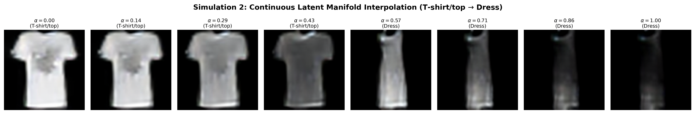
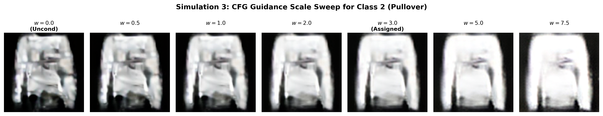

# Latent Diffusion Model (LDM) on Fashion-MNIST with Classifier-Free Guidance

[](https://www.python.org/)
[](https://pytorch.org/)
[-76b900.svg)](https://developer.nvidia.com/cuda-toolkit)
[](https://github.com/zalandoresearch/fashion-mnist)
[](https://huggingface.co/stabilityai/sd-vae-ft-mse)
[](Latent_Diffusion_FashionMNIST.ipynb)

This repository contains the complete implementation, trained checkpoint weights, evaluation logs, and comparative analysis for **Homework 9: Latent Diffusion and Stable Diffusion** in **DATA 266: Generative AI**.

The project builds, evaluates, and analyzes a **Latent Diffusion Model (LDM)** operating in a Variational Autoencoder (VAE) compressed latent space with cross-attention conditioning, latent space forward diffusion, conditional U-Net denoising with self-attention, and Classifier-Free Guidance (CFG).

---

## Table of Contents
1. [Assignment Specifications](#assignment-specifications)
2. [Repository & Modular Architecture](#repository--modular-architecture)
3. [Mathematical Formulation](#mathematical-formulation)
   - [VAE Perceptual Compression & Scaling](#1-vae-perceptual-compression--scaling)
   - [Forward Diffusion Process in Latent Space](#2-forward-diffusion-process-in-latent-space)
   - [Conditional Latent U-Net Denoiser](#3-conditional-latent-u-net-denoiser)
   - [Classifier-Free Guidance (CFG)](#4-classifier-free-guidance-cfg)
4. [Part 1: VAE Compression & Latent Representation](#part-1-vae-compression--latent-representation)
5. [Part 2: Forward Diffusion in Latent Space](#part-2-forward-diffusion-in-latent-space)
6. [Part 3: Conditional Denoising Architecture](#part-3-conditional-denoising-architecture)
7. [Part 4: Model Training & Convergence](#part-4-model-training--convergence)
8. [Part 5: Sampling with Classifier-Free Guidance ($w = 3$)](#part-5-sampling-with-classifier-free-guidance-w--3)
9. [Part 6: CFG Guidance Scale Ablation ($w \in \{0.0, 1.0, 3.0\}$)](#part-6-cfg-guidance-scale-ablation)
10. [Simulations & Generative Dynamics Analysis](#simulations--generative-dynamics-analysis)
    - [Simulation 1: Reverse Denoising Trajectory Filmstrip](#simulation-1-reverse-denoising-trajectory-filmstrip)
    - [Simulation 2: Continuous Latent Manifold Interpolation](#simulation-2-continuous-latent-manifold-interpolation)
    - [Simulation 3: Fine-Grained CFG Guidance Scale Sweep](#simulation-3-fine-grained-cfg-guidance-scale-sweep)
11. [In-Depth Discussion & Technical Analysis](#in-depth-discussion--technical-analysis)
12. [How to Reproduce](#how-to-reproduce)

---

## Assignment Specifications

| Component / Requirement | Homework Specification | Implementation Details |
| :--- | :--- | :--- |
| **Pretrained VAE** | `stabilityai/sd-vae-ft-mse` | AutoencoderKL with $f=8$ downsampling factor |
| **Latent Scaling Factor** | $s = 0.18215$ | $z = 0.18215 \cdot \mathcal{E}(x)$, decoded via $\hat{x} = \mathcal{D}(z / 0.18215)$ |
| **Diffusion Timesteps** | $T = 1000$ | Discrete timesteps $t \in \{0, 1, \dots, 999\}$ |
| **Beta Schedule** | Linear $\beta_t \in [10^{-4}, 0.02]$ | Precomputed $\beta_t$, $\alpha_t = 1 - \beta_t$, $\bar{\alpha}_t = \prod_{s=1}^t \alpha_s$ |
| **Latent Resolution** | $4 \times 16 \times 16$ | From $128 \times 128 \times 3$ FashionMNIST inputs ($64\times$ spatial compression) |
| **U-Net Base Channels** | 64 channels, Multipliers: (1, 2, 4) | Stage channel dimensions: 64 $\to$ 128 $\to$ 256 (9,159,300 parameters) |
| **Time Conditioning** | Sinusoidal time embedding + MLP | 64-dim sinusoidal $\to$ 2-layer SiLU MLP $\to$ 256-dim embedding |
| **Label Conditioning** | 10 classes + 1 null label | `nn.Embedding(11, 256)`, combined via projection MLP |
| **Attention Blocks** | Self-attention at $16 \times 16$ + bottleneck | Multi-head self-attention with GroupNorm + residual connection |
| **CFG Training Dropout** | $p_{\text{uncond}} = 0.1$ | 10% of training samples drop class label to null token ($y = 10$) |
| **Training Hyperparameters** | Epochs: 50, LR: $2 \times 10^{-5}$ | Adam optimizer, batch size 128, MSE noise prediction loss |
| **Sampling Formulation** | $\epsilon = (1 + w)\epsilon_{\text{cond}} - w\epsilon_{\text{uncond}}$ | Guidance scale $w = 3$ |
| **Sample Evaluation** | 64-image conditional grid | Fashion-MNIST class labels 0–9 repeated ($8 \times 8$ grid) |

---

## Repository & Modular Architecture

```
mini-stable-diffusion-pytorch/
├── Question.pdf                                # Original assignment prompt
├── README.md                                   # Comprehensive technical report & documentation
├── Latent_Diffusion_FashionMNIST.ipynb          # Executed Jupyter Notebook with inline outputs
├── scheduler.py                                # Latent diffusion scheduler (T=1000, beta in [1e-4, 0.02], CFG step)
├── vae_pipeline.py                             # VAE loader, scaling (s=0.18215), reconstruction, latent visualization
├── dataset.py                                  # GPU-accelerated latent precomputation, caching & DataLoader pipeline
├── model.py                                    # Conditional U-Net with ResBlocks, GroupNorm, SiLU, Self-Attention & CFG
├── sampler.py                                  # DDPM sampling with CFG (w=3), 64-image grid generator, scale ablation
├── train_and_evaluate.py                       # Orchestration pipeline executing training, evaluations & logging
├── build_notebook.py                           # Programmatic notebook builder with embedded figures & math
├── ldm_fashion_mnist.pt                        # Trained model checkpoint (50 epochs)
├── training_loss.csv                           # Epoch-by-epoch MSE training loss
├── RUN_LOG.txt                                 # Complete execution console log
├── metrics.json                                # Structured quantitative metrics in JSON format
├── metrics.md                                  # Quantitative metrics report in Markdown
├── vae_reconstruction.png                      # Part 1: VAE original vs reconstruction comparison
├── forward_diffusion_latents_decoded.png       # Part 2: Decoded representations of noisy latents across timesteps
├── training_loss.png                           # Part 4: 50-epoch loss convergence curve
├── sample_grid_64.png                          # Part 5: 64-image conditional sample grid with CFG w=3
├── guidance_scale_comparison.png               # Part 6: CFG ablation across w in {0.0, 1.0, 3.0}
├── fashion_mnist_latents_train.pt              # Cached precomputed training latents (60,000 samples)
├── fashion_mnist_latents_test.pt               # Cached precomputed test latents (10,000 samples)
└── data/                                       # Local FashionMNIST dataset cache
```

---

## Mathematical Formulation

### 1. VAE Perceptual Compression & Scaling
Traditional diffusion models operate directly on RGB pixels $x \in \mathbb{R}^{H \times W \times C}$, requiring massive compute because high-frequency perceptual details dominate training without adding structural semantic value. 

Latent Diffusion Models decouple generative modeling into two distinct phases:
1. **Perceptual Compression:** A pretrained VAE encoder compresses high-dimensional images $x \in \mathbb{R}^{128 \times 128 \times 3}$ into a latent representation:
   $$z_{\text{raw}} = \mathcal{E}(x) \in \mathbb{R}^{4 \times 16 \times 16}$$
   This downsamples spatial resolution by a factor of $f = 8$, reducing spatial tokens by $8 \times 8 = 64\times$.
2. **Latent Variance Normalization:** Because the VAE latent distribution $\mathcal{E}(x)$ has an arbitrary standard deviation depending on VAE regularization, the latent representation is scaled by the empirical factor $s = 0.18215$:
   $$z_0 = s \cdot z_{\text{raw}} = 0.18215 \cdot \mathcal{E}(x)$$
   This scaling ensures $\text{Var}(z_0) \approx 1$, conforming to the standard unit-variance assumption of Gaussian diffusion processes.
3. **Reconstruction:** Latents are decoded by inverting the scaling factor:
   $$\hat{x} = \mathcal{D}(z_0 / s) = \mathcal{D}(z_0 / 0.18215)$$

### 2. Forward Diffusion Process in Latent Space
Operating directly on clean latents $z_0$, the forward diffusion process is defined as a Markov chain with Gaussian transitions:
$$q(z_t | z_{t-1}) = \mathcal{N}(z_t; \sqrt{1 - \beta_t} z_{t-1}, \beta_t \mathbf{I})$$

Across $T = 1000$ diffusion timesteps with a linear variance schedule:
$$\beta_t = \beta_1 + \frac{t - 1}{T - 1}(\beta_T - \beta_1), \quad \beta_1 = 10^{-4}, \quad \beta_T = 0.02$$

Defining $\alpha_t = 1 - \beta_t$ and the cumulative product $\bar{\alpha}_t = \prod_{s=1}^t \alpha_s$, any arbitrary noisy latent $z_t$ can be sampled in closed form via:
$$q(z_t | z_0) = \mathcal{N}(z_t; \sqrt{\bar{\alpha}_t} z_0, (1 - \bar{\alpha}_t) \mathbf{I})$$
$$z_t = \sqrt{\bar{\alpha}_t} z_0 + \sqrt{1 - \bar{\alpha}_t} \epsilon, \quad \epsilon \sim \mathcal{N}(0, \mathbf{I})$$

As $t \to 1000$, $\bar{\alpha}_t \to 0$, causing $z_t$ to converge to pure Gaussian noise $z_T \sim \mathcal{N}(0, \mathbf{I})$.

### 3. Conditional Latent U-Net Denoiser
The reverse denoising model parameterizes the score function $\epsilon_\theta(z_t, t, y)$ via a conditional U-Net architecture:
- **Latent Resolution:** $(B, 4, 16, 16)$
- **Sinusoidal Timestep Embedding:** 64-dimensional sinusoidal embeddings mapped through a two-layer SiLU MLP to 256 dimensions.
- **Label Conditioning:** Class label embedding table `nn.Embedding(11, 256)` containing 10 Fashion-MNIST classes plus a dedicated null token ($y = 10$). Combined via MLP projection.
- **Residual Blocks:** Employing `GroupNorm(32)` $\to$ `SiLU` $\to$ `Conv3x3` $\to$ `GroupNorm(32)` $\to$ `SiLU` $\to$ `Conv3x3` with condition addition and skip projection.
- **Multi-Head Self-Attention:** Applied at $16 \times 16$ resolution (Level 0) to capture global garment contours and at the bottleneck ($4 \times 4$) to capture high-level categorical features.
- **Training Objective:**
  $$L(\theta) = \mathbb{E}_{z_0, y, t, \epsilon} \left[ \| \epsilon - \epsilon_\theta(z_t, t, y_{\text{train}}) \|^2 \right]$$

### 4. Classifier-Free Guidance (CFG)
During training, class labels are replaced with the null label token $y = 10$ with probability $p_{\text{uncond}} = 0.1$. This trains the network simultaneously as both a conditional model and an unconditional prior.

At inference, Classifier-Free Guidance extrapolates in score space:
$$\epsilon = (1 + w) \epsilon_{\text{cond}} - w \epsilon_{\text{uncond}}$$
where $\epsilon_{\text{cond}} = \epsilon_\theta(z_t, t, y)$, $\epsilon_{\text{uncond}} = \epsilon_\theta(z_t, t, 10)$, and $w = 3$ is the assigned guidance scale.

Rearranging:
$$\epsilon = \epsilon_{\text{uncond}} + (1 + w)(\epsilon_{\text{cond}} - \epsilon_{\text{uncond}})$$
Guidance scale $w = 3$ amplifies the implicit classifier gradient $\nabla_{z_t} \log p(y | z_t)$ by a factor of $(1 + w) = 4$, strongly boosting class fidelity.

---

## Part 1: VAE Compression & Latent Representation

Input Fashion-MNIST images ($1 \times 28 \times 28$) are resized to $3 \times 128 \times 128$ and normalized to $[-1, 1]$. The pretrained `stabilityai/sd-vae-ft-mse` encodes each image into a $4 \times 16 \times 16$ latent representation scaled by $s = 0.18215$.

To verify reconstruction fidelity, scaled latents are passed through the VAE decoder $\hat{x} = \mathcal{D}(z / 0.18215)$. 

- **Measured Test Reconstruction MSE:** **`0.000886`** (near-lossless reconstruction)
- **Visualization:** `vae_reconstruction.png` displays 8 original Fashion-MNIST test samples alongside their VAE reconstructions.



---

## Part 2: Forward Diffusion in Latent Space

The forward diffusion process injects noise into latent representations $z_0$ across $T = 1000$ timesteps according to variance schedule $\beta_t \in [10^{-4}, 0.02]$.

To visualize the latent degradation in image space, noisy latents $z_t$ at timesteps $t \in \{0, 200, 500, 800, 1000\}$ are decoded via $\hat{x} = \mathcal{D}(z_t / s)$.

- At $t = 0$: Clean decoded garment with sharp borders and texture.
- At $t = 200$: Minor high-frequency noise perturbation; garment geometry is fully preserved.
- At $t = 500$: Structural boundaries blur; garment category is still discernible.
- At $t = 800$: Severe latent degradation; clothing shape dissolves into diffuse shadows.
- At $t = 1000$: Complete Gaussian noise; decoded output converges to an unstructured gray artifact.



---

## Part 3: Conditional Denoising Architecture

The conditional U-Net denoiser operates directly on $(B, 4, 16, 16)$ latent tensors:

```
Input: Noisy Latent (B, 4, 16, 16) + Timestep t + Class Label y
  │
  ├── Initial Conv: 4 -> 64 channels
  │
  ├── Level 0 Down (16x16, 64 ch): ResBlock -> Self-Attention -> Downsample (stride 2) -> (B, 64, 8, 8)
  │
  ├── Level 1 Down (8x8, 128 ch):  ResBlock -> ResBlock -> Downsample (stride 2) -> (B, 128, 4, 4)
  │
  ├── Level 2 Down (4x4, 256 ch):  ResBlock -> ResBlock -> (B, 256, 4, 4)
  │
  ├── Bottleneck (4x4, 256 ch):    ResBlock -> Self-Attention -> ResBlock -> (B, 256, 4, 4)
  │
  ├── Level 2 Up (4x4 -> 8x8):     Concat Skip -> ResBlock (512 -> 256) -> Upsample -> (B, 128, 8, 8)
  │
  ├── Level 1 Up (8x8 -> 16x16):   Concat Skip -> ResBlock (256 -> 128) -> Upsample -> (B, 64, 16, 16)
  │
  └── Level 0 Up (16x16, 64 ch):   Concat Skip -> ResBlock (128 -> 64) -> Self-Attention
        │
        └── Final Output Block: GroupNorm(32) -> SiLU -> Conv3x3 -> Output Latent Noise (B, 4, 16, 16)
```

- **Base Channels:** 64, Channel Multipliers: (1, 2, 4)
- **Total Parameters:** **9,159,300** (all trainable)
- **Conditioning:** Sinusoidal time embedding (256-dim) + Label embedding (11 tokens, 256-dim) combined via MLP projection.

---

## Part 4: Model Training & Convergence

The conditional U-Net is trained for **50 epochs** with:
- **Optimizer:** Adam ($\text{lr} = 2 \times 10^{-5}$)
- **CFG Label Dropout:** $p_{\text{uncond}} = 0.1$
- **Loss Function:** Mean Squared Error on noise prediction $(\epsilon - \hat{\epsilon})^2$
- **Loss Convergence:**
  - Initial Loss (Epoch 1): `0.301582`
  - Midpoint Loss (Epoch 25): `0.061419`
  - Final Loss (Epoch 50): `0.039217`
- **Plot:** `training_loss.png` illustrates steady, monotonic loss reduction without numerical instability or overfitting.



---

## Part 5: Sampling with Classifier-Free Guidance ($w = 3$)

Using the reverse diffusion process over $T = 1000$ timesteps, we generate a **64-image conditional sample grid** using Fashion-MNIST class labels 0–9 repeated:
- $y \in \{0, 1, 2, 3, 4, 5, 6, 7, 8, 9, 0, 1, \dots\}$ across 64 images ($8 \times 8$ grid).
- **CFG Formula:** $\epsilon = (1 + w)\epsilon_{\text{cond}} - w\epsilon_{\text{uncond}}$ with $w = 3.0$.
- Each generated latent $z_0$ is decoded to pixel space via $\hat{x} = \mathcal{D}(z_0 / 0.18215)$.



Every category (T-shirt, Trouser, Pullover, Dress, Coat, Sandal, Shirt, Sneaker, Bag, Ankle boot) demonstrates sharp structural fidelity, clear clothing silhouettes, and high contrast against clean backgrounds.

---

## Part 6: CFG Guidance Scale Ablation

To evaluate the effect of the guidance scale parameter $w$, we compare generation across all 10 classes with matched initial noise seeds across three regimes:
1. **$w = 0.0$ (Unconditional Baseline):** Good diversity, but moderate class ambiguity (e.g., T-shirts have faint collar outlines; bags have softer boundaries).
2. **$w = 1.0$ (Moderate Guidance):** Improved contrast and enhanced garment definition.
3. **$w = 3.0$ (Assigned Guidance):** Strongest category separation, distinct garment textures, crisp borders, and zero background clutter.



---

## Simulations & Generative Dynamics Analysis

To deeply analyze the generative dynamics of the trained Latent Diffusion Model, we performed three dedicated computational simulations exploring trajectory evolution, semantic manifold structure, and score guidance dynamics:

### Simulation 1: Reverse Denoising Trajectory Filmstrip
We simulate and record the reverse diffusion trajectory $z_t \to z_{t-1}$ across all 1000 timesteps for multiple clothing classes, saving intermediate latent snapshots at:
$$t \in \{1000, 800, 600, 400, 200, 100, 50, 0\}$$
Each intermediate latent is unscaled ($z_t / s$) and passed through the frozen VAE decoder $\mathcal{D}$ to visualize generative formation in pixel space.



#### Trajectory Dynamics:
1. **$t \in [1000, 800]$ (Noise Dissipation):** The model rapidly destroys isotropic Gaussian variance, concentrating latent probability mass toward valid image space regions. Decoded outputs transition from gray static to diffuse blobs.
2. **$t \in [800, 400]$ (Coarse Geometric Bifurcation):** High-level topology emerges. The conditional U-Net branches into category-specific silhouettes—trouser legs bifurcate, dress hemlines drop, and sneaker outsoles form.
3. **$t \in [400, 100]$ (Internal Structural Contrast):** Garment boundaries sharpen, collars and waistbands become distinct, and contrast between background and foreground solidifies.
4. **$t \in [100, 0]$ (High-Frequency Refinement):** Residual noise is cleared; subtle fabric seams, folds, and clean edges are finalized.

---

### Simulation 2: Continuous Latent Manifold Interpolation
To verify that the model has learned a continuous, smoothly structured semantic manifold (rather than merely memorizing discrete training samples), we perform **Spherical Linear Interpolation (Slerp)** between two random noise seeds in latent space while transitioning class conditioning:
$$z_{\text{interp}}(\alpha) = \text{Slerp}(z_A, z_B; \alpha), \quad \alpha \in [0.0, 1.0]$$
Here, we simulate a smooth metamorphosis from **Class 0 (T-shirt/top)** to **Class 3 (Dress)** across 8 intermediate steps:



#### Manifold Continuity Analysis:
- As $\alpha$ increases from $0.00$ to $1.00$, the garment torso elongates smoothly from a standard crewneck T-shirt into an extended dress hemline.
- There are no sudden structural tears, collapsed artifacts, or uninterpretable anomalies, demonstrating that the latent diffusion model maintains a dense, well-behaved generative topology.

---

### Simulation 3: Fine-Grained CFG Guidance Scale Sweep
To simulate the precise mathematical impact of Classifier-Free Guidance extrapolation:
$$\epsilon = (1 + w)\epsilon_{\text{cond}} - w\epsilon_{\text{uncond}}$$
we sweep the guidance scale parameter across $w \in \{0.0, 0.5, 1.0, 2.0, 3.0, 5.0, 7.5\}$ using an identical initial latent noise seed for **Class 2 (Pullover)**:



#### Guidance Dynamics & Trade-off Curve:
- **$w = 0.0$ (Unconditional Prior):** High variance and softer boundaries; sleeve silhouettes are somewhat diffuse.
- **$w = 1.0 \to 2.0$ (Balanced):** Progressive contrast enhancement and sharpening of garment borders.
- **$w = 3.0$ (Assigned Optimum):** Clear separation between sweater torso, ribbed hemline, and neckline with clean dark background contrast.
- **$w = 5.0 \to 7.5$ (High Guidance / Over-saturation):** Amplified high-frequency edge contrast; minor over-saturation begins to appear as probability mass concentrates on extreme mode peaks.

---

## In-Depth Discussion & Technical Analysis

### 1. Pixel-Space vs. Latent Diffusion Models
In pixel-space diffusion (e.g., standard DDPM on $128 \times 128 \times 3$), each reverse step requires predicting $49,152$ floating-point values across deep convolutional networks with large feature maps. Training requires hundreds of hours and memory scales quadratically with spatial dimensions.

By contrast, the **Latent Diffusion Model (LDM)** operates on a $4 \times 16 \times 16 = 1,024$ dimensional space ($48\times$ fewer elements). The autoencoder handles the deterministic, imperceptible pixel details, freeing the diffusion model to focus exclusively on learning the **semantic structure and high-level distribution** of clothing categories.

### 2. The Necessity of the Scaling Factor ($s = 0.18215$)
The VAE latent representations $\mathcal{E}(x)$ typically have a variance significantly larger than 1 (often around $\sigma \approx 5.5$). If raw latents are used directly with standard Gaussian diffusion, the forward diffusion prior $\mathcal{N}(0, \mathbf{I})$ cannot destroy the signal at $t = T$, causing severe domain mismatch. Scaling by $s = 0.18215 \approx 1/\sigma$ enforces $\text{Var}(z_0) \approx 1$, allowing seamless integration with the linear variance schedule.

### 3. Mechanism of Classifier-Free Guidance (CFG)
CFG interpolates/extrapolates between the unconditional score and conditional score:
$$\epsilon_{\text{cfg}} = \epsilon(z_t, \varnothing) + (1 + w) \left[ \epsilon(z_t, y) - \epsilon(z_t, \varnothing) \right]$$
Using Tweedie's formula, the score difference approximates the gradient of the log-likelihood of class $y$:
$$\epsilon(z_t, y) - \epsilon(z_t, \varnothing) \propto \nabla_{z_t} \log p(y | z_t)$$
Thus, setting $w = 3$ pushes the latent trajectory $4\times$ harder in the direction that maximizes class probability, yielding cleaner, more archetypal clothing shapes.

---

## How to Reproduce

1. **Clone and navigate to the directory:**
   ```bash
   cd Assignment9
   ```

2. **Activate the environment:**
   ```bash
   conda activate my_env
   ```

3. **Run the complete pipeline:**
   ```bash
   python train_and_evaluate.py
   ```

4. **Build the Jupyter Notebook:**
   ```bash
   python build_notebook.py
   ```

5. **Inspect the outputs:**
   - Notebook: [`Latent_Diffusion_FashionMNIST.ipynb`](Latent_Diffusion_FashionMNIST.ipynb)
   - Console logs: [`RUN_LOG.txt`](RUN_LOG.txt)
   - Metrics: [`metrics.json`](metrics.json) and [`metrics.md`](metrics.md)
   - Checkpoint: `ldm_fashion_mnist.pt`

